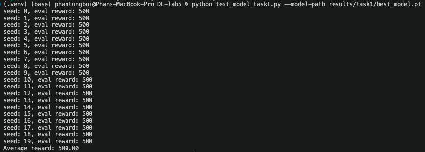
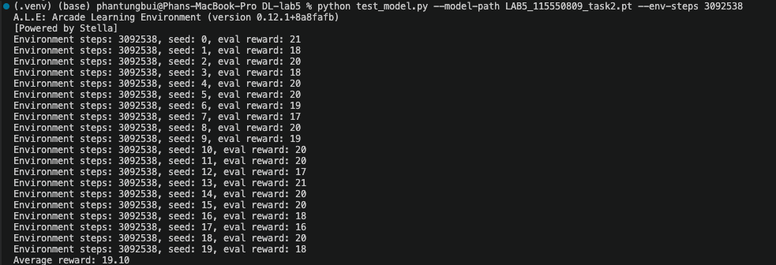
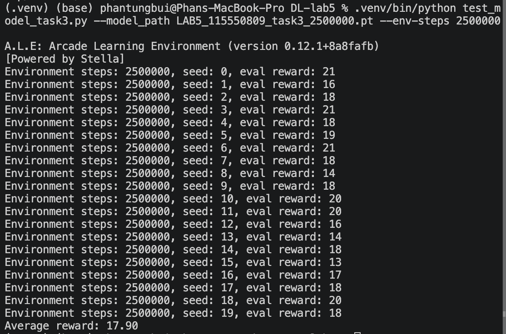
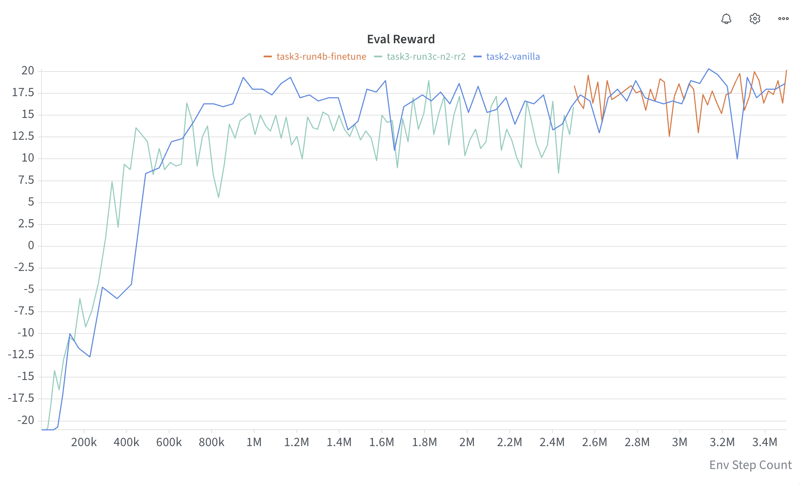

# Lab 5: Value-Based Reinforcement Learning

**Course:** 535528 Deep Learning, Fall 2026
**Student:** Phan Tung Bui — Student ID: `115550809`

> Sections marked **TODO** are still to be filled in (Tasks 2–3 have not been trained yet).
> Replace every `screenshots/...png` placeholder with your own image (create a `screenshots/` folder next to this file, or change the paths).

---

## 1. Introduction

This lab implements Deep Q-Networks (DQN) and evaluates them on two environments of increasing difficulty:

| Task | Environment | Observation | Q-network | Goal |
|---|---|---|---|---|
| 1 | CartPole-v1 | 4-dim state vector | MLP | average score ≥ 480 over 20 episodes |
| 2 | ALE/Pong-v5 | stacked 84×84 grayscale frames | CNN | average score ≥ 19 over 20 episodes |
| 3 | ALE/Pong-v5 | same as Task 2 | CNN + Double DQN, PER, multi-step return | reach score 19 in as few environment steps as possible |

**Main findings so far**

- **Task 1:** Vanilla DQN with a 4 → 64 → 64 → 2 MLP solves CartPole. The best snapshot (saved at ≈ 95.7k environment steps) scores **500.00 on all 20 evaluation seeds (0–19)**, the maximum possible.
- **Hyperparameters matter a lot.** With the same algorithm, configurations ranged from never learning at all to solving the task reliably (Section 4.4). The learning rate was the most important setting: 1e-3 learned fast but kept collapsing, 1e-4 was stable but too slow, and 5e-4 worked best.
- **Time-limit truncation must not be treated as termination.** CartPole cuts episodes off at 500 steps; storing that as a terminal transition is a known source of biased targets, so only real terminations zero out the bootstrap term (Section 2.1).
- **TODO:** Task 2 and Task 3 findings.

**Organization.** Section 2 describes the implementation (Bellman error, Double DQN, PER, multi-step return, W&B logging). Section 3 lists the evaluation commands and screenshots. Section 4 shows training curves and analysis. Section 5 covers additional experiments.

---

## 2. Implementation

### 2.1 Vanilla DQN and the Bellman error (Task 1)

**Concept.** DQN approximates the action-value function Q(s, a), the expected discounted return from taking action *a* in state *s* and acting greedily afterwards. It minimizes the squared Bellman error (handout eq. 1):

$$
L_{\text{DQN}}(\theta) = \frac{1}{2}\sum_{(s,a,r,s')\in D}\Big(r + \gamma\max_{a'}Q(s',a';\bar\theta) - Q(s,a;\theta)\Big)^2
$$

Two techniques stabilize training (DL-7, slides 52–55):

- **Experience replay.** Transitions (s, a, r, s′, terminated) are stored in a FIFO buffer and mini-batches are sampled uniformly. This breaks the correlation between consecutive samples and reuses data.
- **Target network.** The target uses a separate, periodically synced copy of the network (θ̄), so the regression target does not move every time θ is updated.

**Q-network (CartPole).** A fully connected network: 4 → 64 → 64 → 2, ReLU activations, no activation on the output layer (Q-values are unbounded). It has 4,610 parameters.

```python
self.network = nn.Sequential(
    nn.Linear(4, 64),
    nn.ReLU(),
    nn.Linear(64, 64),
    nn.ReLU(),
    nn.Linear(64, num_actions)
)
```

**Observation handling.** CartPole's observation is already a compact 4-dim state containing velocities, so the `AtariPreprocessor` (grayscale / resize / frame stack) is bypassed and the raw observation is used as the state.

**Replay buffer.** `collections.deque(maxlen=memory_size)`; mini-batches are drawn with `random.sample(self.memory, batch_size)`.

**Computing the Bellman error.** For a sampled batch, the prediction is the Q-value of the action actually taken, and the target is computed with the frozen target network without tracking gradients:

```python
q_values = self.q_net(states).gather(1, actions.unsqueeze(1)).squeeze(1)

with torch.no_grad():
    next_q_values = self.target_net(next_states).max(dim=1).values
    targets = rewards + self.gamma * next_q_values * (1 - dones)

loss = nn.functional.mse_loss(q_values, targets)
self.optimizer.zero_grad()
loss.backward()
nn.utils.clip_grad_norm_(self.q_net.parameters(), max_norm=10.0)
self.optimizer.step()
```

The Bellman error is `targets - q_values`. The `(1 - dones)` factor removes the bootstrap term for terminal transitions. Gradient-norm clipping (max 10) guards against occasional very large updates. Every `target_update_frequency` updates, the target network is synced with `target_net.load_state_dict(q_net.state_dict())`.

**Terminated vs. truncated.** Gymnasium returns two flags: `terminated` (the pole fell, a true terminal state) and `truncated` (the 500-step time limit). The episode loop ends on either, but the replay buffer stores only `terminated`:

```python
done = terminated or truncated          # ends the episode loop
self.memory.append((state, action, reward, next_state, terminated))  # bootstrap flag
```

If truncation were stored as terminal, a well-balanced state at step 500 would get target `r` instead of `r + γ max Q(s′)`. Since the state does not include the time step, the network would receive contradictory targets for near-identical states.

**ε-greedy exploration.** With probability ε a random action is taken, otherwise argmax Q. ε is multiplied by `epsilon_decay` after every update, from 1.0 down to `epsilon_min = 0.05`. With decay 0.9995, ε reaches 0.05 after ≈ 6,000 updates.

**Evaluation and model selection.** Every 20 training episodes, the greedy policy (ε = 0) is evaluated over 5 episodes and the **average** is used. The model is saved as `best_model.pt` whenever this average improves. Averaging several episodes avoids saving a model that scored 500 once by luck.

### 2.2 Visual observations on Atari (Task 2) — TODO

- Preprocessing: grayscale, resize to 84×84, stack 4 frames (`AtariPreprocessor`).
- CNN architecture: **TODO**
- Reward scaling / clipping, frame skip, other choices: **TODO**

### 2.3 Double DQN (Task 3) — TODO

**Concept.** The max in the DQN target uses the same network to select and evaluate the next action, which overestimates Q-values. Double DQN selects with the online network and evaluates with the target network (handout eq. 2):

$$
y = r + \gamma\, Q\big(s', \arg\max_{a'} Q(s',a';\theta);\ \bar\theta\big)
$$

**Implementation:** **TODO** (code snippet)

### 2.4 Prioritized Experience Replay (Task 3) — TODO

**Concept.** Transition *i* gets priority p_i = |δ_i| + ε and is sampled with probability P(i) = p_i^α / Σ_k p_k^α. Importance-sampling weights w_i = (N · P(i))^(−β), normalized by their maximum, correct the bias.

**Implementation:** **TODO** (data structure, how priorities are updated, β schedule)

### 2.5 Multi-step return (Task 3) — TODO

**Concept.** Replace the 1-step target with the n-step return:

$$
R_t^{(n)} = \sum_{k=0}^{n-1}\gamma^k r_{t+k} + \gamma^n \max_{a'} Q(s_{t+n},a')
$$

**Implementation:** **TODO** (n, how the n-step buffer handles episode ends)

### 2.6 Weights & Biases tracking

Training is logged with `wandb.log(...)`:

| Metric | When | Meaning |
|---|---|---|
| `Total Reward` | every episode | training-episode return (includes ε-random actions) |
| `Eval Reward` | every 20 episodes | average greedy return over 5 evaluation episodes |
| `Epsilon` | every episode and every 1,000 steps | current exploration rate |
| `Env Step Count` | with every log | total environment steps so far (**x-axis of all plots**) |
| `Update Count` | with every log | number of gradient updates |

All plots use `Env Step Count` as the x-axis, as required.

---

## 3. Evaluation Results (Snapshots)

### 3.1 Task 1 — CartPole-v1

**Command**

```bash
python test_model_task1.py --model-path LAB5_115550809_task1.pt
```

`test_model_task1.py` loads the snapshot, runs 20 greedy episodes with seeds 0–19 and prints the average reward.

**Result: average reward 500.00 over 20 episodes** (every seed scored 500).



### 3.2 Task 2 — Pong-v5 — TODO

```bash
python test_model.py --model-path LAB5_115550809_task2.pt   # TODO: confirm command
```

**Result:** TODO



### 3.3 Task 3 — Enhanced DQN on Pong-v5 — TODO

| Snapshot | Env steps | Average score (20 episodes) | Screenshot |
|---|---|---|---|
| `LAB5_115550809_task3_600000.pt` | 600k | TODO |  |
| `LAB5_115550809_task3_1000000.pt` | 1M | TODO |  |
| `LAB5_115550809_task3_1500000.pt` | 1.5M | TODO |  |
| `LAB5_115550809_task3_2000000.pt` | 2M | TODO |  |
| `LAB5_115550809_task3_2500000.pt` | 2.5M | TODO |  |
| `LAB5_115550809_task3_best.pt` | TODO | TODO |  |

**First time reaching score 19:** TODO env steps (justify with the W&B curve).

---

## 4. Analysis and Discussion

### 4.1 Task 1 training curve

W&B run: `task1-final` (project `DLP-Lab5-DQN-CartPole`).


**Hyperparameters (final run)**

| Hyperparameter | Value |
|---|---|
| Learning rate (Adam) | 5e-4 |
| Discount factor γ | 0.99 |
| Batch size | 64 |
| Replay memory size | 50,000 |
| Replay start size | 1,000 |
| ε start / min / decay (per update) | 1.0 / 0.05 / 0.9995 |
| Target network update | every 500 updates |
| Updates per environment step | 1 |
| Training episodes | 800 |
| Evaluation | 5 greedy episodes every 20 training episodes |
| Loss | MSE, gradient-norm clip 10 |

**Learning progress (average of 5 evaluation episodes)**

| Env steps | Eval reward | Phase |
|---|---|---|
| 0 – 2k | ≈ 9 | random play, replay buffer warming up |
| ≈ 7k | 278 | fast initial learning |
| 10k – 72k | 113 – 328 | plateau |
| ≈ 86k | 476 | breakthrough |
| **≈ 96k – 127k** | **500** | solved (best model saved at ≈ 95.7k) |
| ≈ 132k – 142k | 160 – 343 | temporary performance drop |
| ≈ 150k – 160k | 500 | recovered |

**Discussion.**

- The agent learns a decent policy within ≈ 7k steps but then plateaus for ≈ 65k steps before solving the task. During the plateau the agent typically balances for a few hundred steps and then drifts off the track.
- After solving, performance dropped temporarily around 132k–142k steps. DQN keeps updating its weights after reaching the optimum; once the replay buffer is dominated by "balanced" states, the network gets fewer examples of recovering from bad states and can partially forget them. This is why the best snapshot is kept rather than the final one.

### 4.2 Task 2 training curve — TODO


### 4.3 Task 3 training curve and sample efficiency — TODO



- Sample efficiency with vs. without enhancements: TODO
- Ablation (each technique separately): TODO

| Variant | Env steps to reach score 19 | Final score |
|---|---|---|
| Vanilla DQN (Task 2) | TODO | TODO |
| + Double DQN only | TODO | TODO |
| + PER only | TODO | TODO |
| + Multi-step only | TODO | TODO |
| All three (Task 3) | TODO | TODO |

### 4.4 Hyperparameter study on CartPole

Before the final run, eight configurations were compared, each for a single seed with W&B disabled. The "best eval" column is the best 5-episode average reached during training; the last column is the best snapshot evaluated on seeds 0–19.

**Round 1** (600 episodes; truncation stored as terminal)

| Run | lr | Target update | Batch | Replay start | ε decay | Best eval | Notes |
|---|---|---|---|---|---|---|---|
| A | 5e-4 | 500 | 32 | 500 | 0.999 | 309 | drifted down to ≈ 150, collapsed near the end |
| B | 2.5e-4 | 1000 | 64 | 1000 | 0.9995 | 272 | stayed around 160–270 |
| C | 1e-4 | 1000 | 64 | 1000 | 0.9995 | 322 | slid down to ≈ 170 |
| D | 5e-4 | 2000 | 64 | 1000 | 0.9995 | 14 | did not learn within 7k steps |

**Round 2** (800 episodes; truncation not treated as terminal; batch 64, replay start 1000, ε decay 0.9995)

| Run | lr | Target update | Best eval | Behavior | 20-seed score of best model |
|---|---|---|---|---|---|
| **E** | 5e-4 | 500 | 500 | 500 at every evaluation from ≈ 94k to 160k steps | **500.00** |
| F | 1e-3 | 200 | 500 | reached 500 by ≈ 52k steps but repeatedly collapsed (500 → 78 → 500 → 36 …) | 500.00 |
| G | 2.5e-4 | 1000 | 246 | stayed around 130–250 | 190.60 |
| H | 1e-4 | 1000 | 355 | steady around 200–350 | 344.25 |

**Observations.**

- **Learning rate.** A high learning rate (1e-3) learns fastest but is unstable; low ones (1e-4, 2.5e-4) are stable but too slow for the training budget. 5e-4 was the best compromise.
- **Target update frequency.** Very frequent syncs (every 200 updates, run F) contributed to oscillations (a moving target). Very infrequent syncs (every 2,000 updates, run D) slowed early learning.
- **Truncation handling.** Runs B→G and C→H differ only in the truncation fix and gave similar results within this budget, so this single-seed experiment does not show a clear empirical effect. The fix is kept because it makes the targets correct.
- **Limitation.** Every configuration was run with one seed, so differences of a few dozen reward points are within run-to-run noise.

---

## 5. Additional Analysis (Bonus) — optional

TODO: e.g. Huber vs. MSE loss, soft target updates, learning-rate schedules, reward clipping on Pong.

---

## Appendix: How to Reproduce

```bash
pip install -r requirements.txt
wandb login
```

**Task 1 training**

```bash
python dqn.py --wandb-run-name task1-final --lr 5e-4 --target-update-frequency 500 \
  --batch-size 64 --replay-start-size 1000 --epsilon-decay 0.9995 \
  --memory-size 50000 --episodes 800 --eval-episodes 5 --save-dir ./results/task1
```

**Task 1 evaluation**

```bash
python test_model_task1.py --model-path LAB5_115550809_task1.pt
```

**Task 2 / Task 3:** TODO
