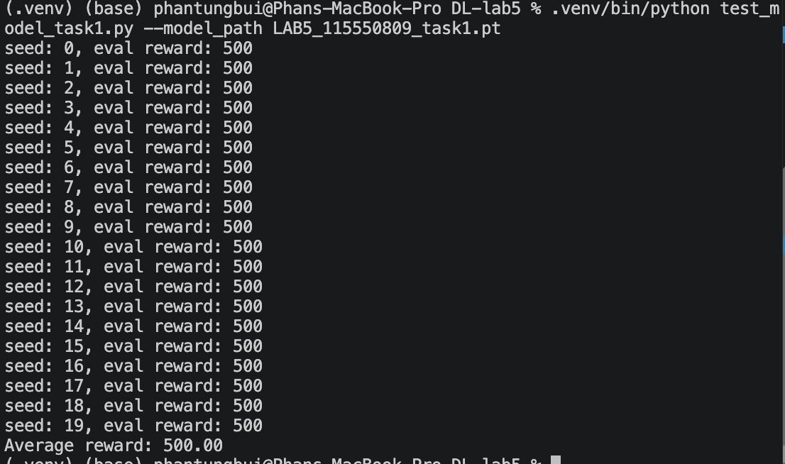
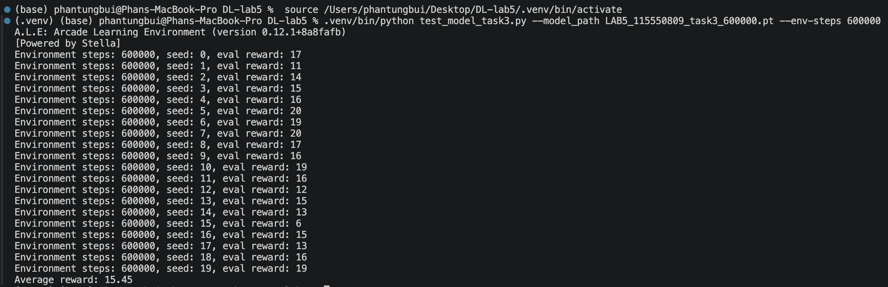
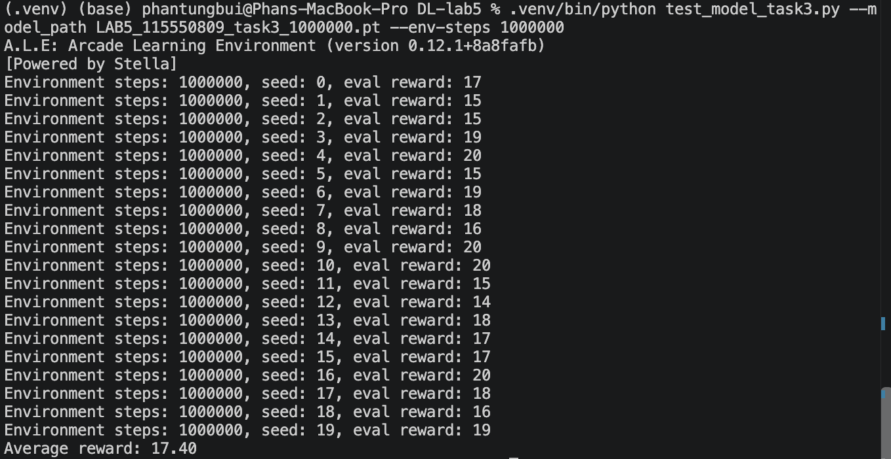
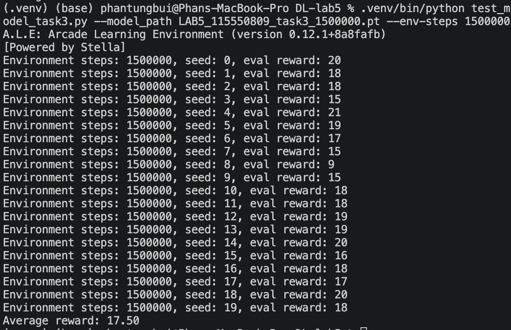
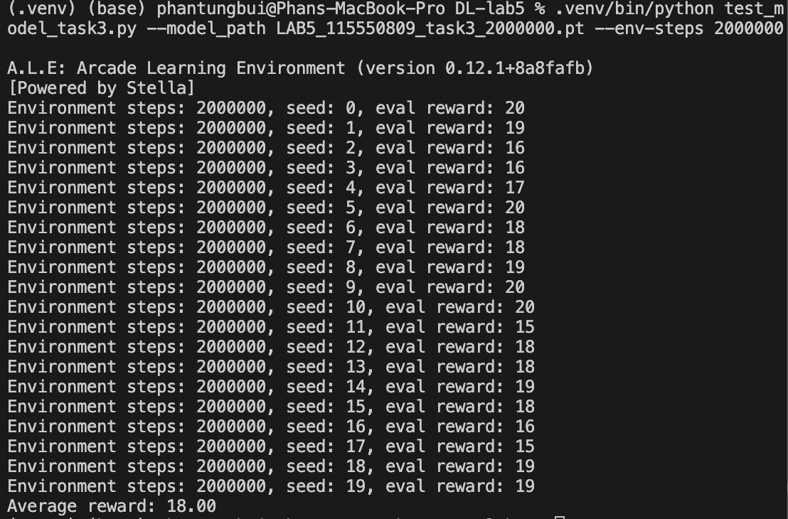
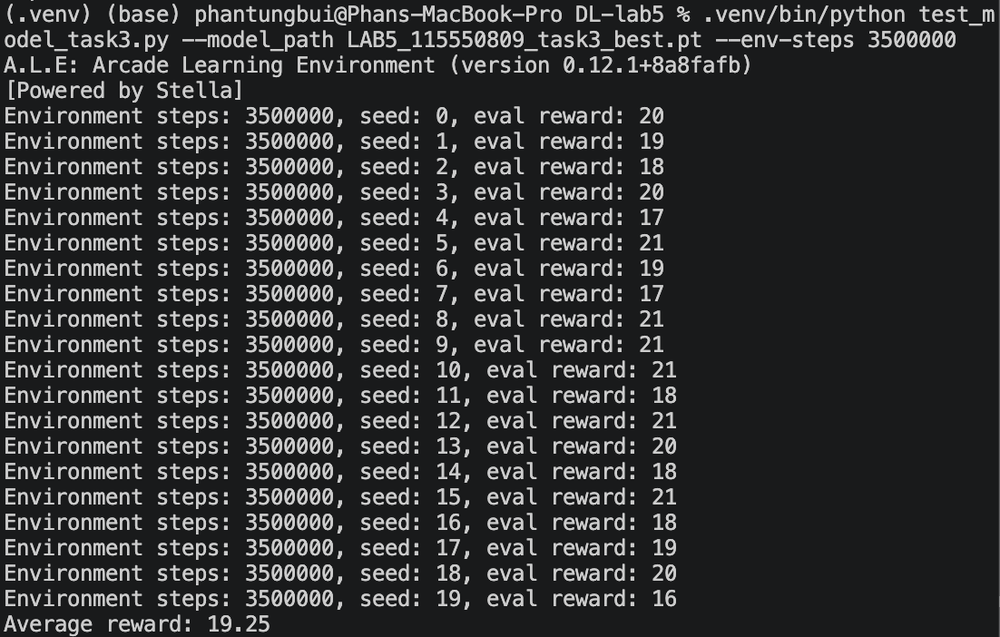
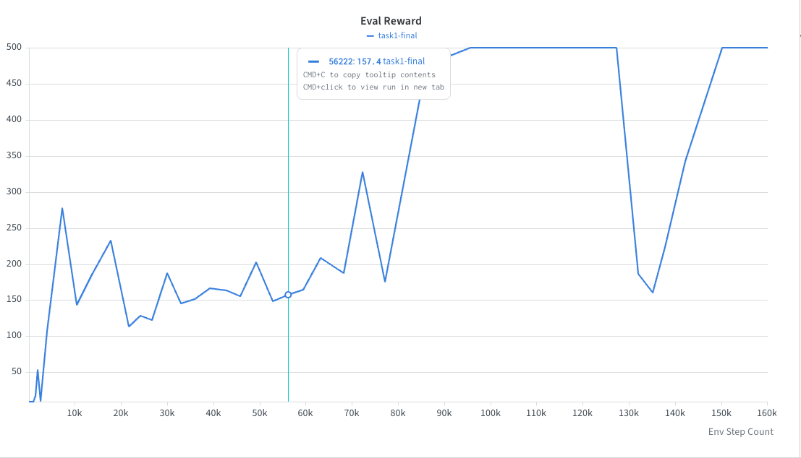
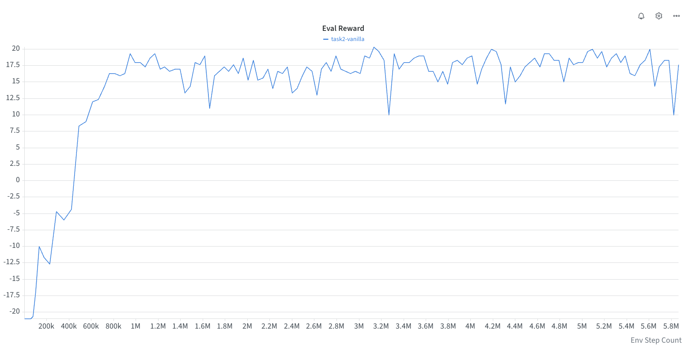

# Lab 5: Value-Based Reinforcement Learning

**Course:** 535528 Deep Learning, Fall 2026
**Student:** Phan Tung Bui — Student ID: `115550809`

---

## 1. Introduction

This lab implements Deep Q-Networks (DQN) and evaluates them on two environments of increasing difficulty:

| Task | Environment | Observation | Q-network | Goal |
|---|---|---|---|---|
| 1 | CartPole-v1 | 4-dim state vector | MLP | average score ≥ 480 over 20 episodes |
| 2 | ALE/Pong-v5 | stacked 84×84 grayscale frames | CNN | average score ≥ 19 over 20 episodes |
| 3 | ALE/Pong-v5 | same as Task 2 | CNN + Double DQN, PER, multi-step return | reach score 19 in as few environment steps as possible |

**Main findings**

- **Task 1:** Vanilla DQN with a 4 → 64 → 64 → 2 MLP solves CartPole. The best snapshot (saved at ≈ 95.7k environment steps) scores **500.00 on all 20 evaluation seeds (0–19)**, the maximum possible.
- **Hyperparameters matter a lot.** With the same algorithm, configurations ranged from never learning at all to solving the task reliably (Section 5.1). The learning rate was the most important setting: 1e-3 learned fast but kept collapsing, 1e-4 was stable but too slow, and 5e-4 worked best.
- **Time-limit truncation must not be treated as termination.** CartPole cuts episodes off at 500 steps; storing that as a terminal transition is a known source of biased targets, so only real terminations zero out the bootstrap term (Section 2.1).
- **Task 2:** Vanilla DQN with the Nature-DQN CNN learns Pong from pixels. The 3-game evaluation average first reached 19 at ≈ 0.95M environment steps. The submitted snapshot (≈ 3.09M steps) averages **19.10 over seeds 0–19**.
- **Model selection needs a reliable evaluation.** On Pong, the "best" model chosen during training from a 3-game average scored only 17.40 on the 20-seed test, while an earlier checkpoint scored 19.10 (Section 4.2).
- **Task 3:** Double DQN, PER and a multi-step return make early learning much faster. The best configuration (2-step return, two updates per environment step) reaches scores of 10, 15 and 17 with ≈ 1.6× fewer environment steps than vanilla DQN when its weights are averaged over time (≈ 1.1–1.4× up to a score of 15 without averaging), and its 600k snapshot beats vanilla's (15.45 vs 13.80). It then levels off at ≈ 17–18. Continuing it with a 1-step return, one update per step and a lower learning rate reached **19.25 on seeds 0–19 at 3.5M environment steps**. That is later than vanilla DQN's first 20-seed score above 19 (3.09M), so the enhancements sped up early learning but not reaching 19.
- **The uncorrected multi-step return limits the final score.** The ablation study shows the 3-step return is the fastest technique early on but has the lowest ceiling. Shorter returns (n = 2, then n = 1) raised the ceiling step by step (Section 4.3).
- **Single snapshots are noisy; averaging weights helps.** With two updates per step, the raw network's 20-seed score swung by several points between snapshots. Averaging its weights over time added 4–5 points at 1M steps, without changing training.

Slide references ("DL-7, slide 67") point to the course's value-based RL lecture deck, file `DL7`; the handout calls this material Lecture 8.

**Organization.** Section 2 describes the implementation (Bellman error, Double DQN, PER, multi-step return, W&B logging). Section 3 lists the evaluation commands and screenshots. Section 4 shows training curves and analysis. Section 5 covers additional experiments (bonus): the CartPole hyperparameter study and other training strategies on Pong (weight averaging, replay ratio, multi-step length, a fine-tuning phase, dueling and soft target updates).

---

## 2. Implementation

### 2.1 Vanilla DQN and the Bellman error (Task 1)

**Concept.** DQN approximates the action-value function Q(s, a), the expected discounted return from taking action *a* in state *s* and acting greedily afterwards. It minimizes the squared Bellman error (handout eq. 1):

$$
L_{\text{DQN}}(\theta) = \frac{1}{2}\sum_{(s,a,r,s')\in D}\Big(r + \gamma\max_{a'}Q(s',a';\bar\theta) - Q(s,a;\theta)\Big)^2
$$

Two techniques stabilize training (DL-7, slides 52–55):

- **Experience replay.** Transitions (s, a, r, s′, terminated) are stored in a FIFO buffer and mini-batches are sampled uniformly. This breaks the correlation between consecutive samples and reuses data.
- **Target network.** The target uses a separate, periodically synced copy of the network (θ̄), so the regression target does not move every time θ is updated.

**Q-network (CartPole).** A fully connected network: 4 → 64 → 64 → 2, ReLU activations, no activation on the output layer (Q-values are unbounded). It has 4,610 parameters.

```python
self.network = nn.Sequential(
    nn.Linear(4, 64),
    nn.ReLU(),
    nn.Linear(64, 64),
    nn.ReLU(),
    nn.Linear(64, num_actions)
)
```

**Observation handling.** CartPole's observation is already a compact 4-dim state containing velocities, so the `AtariPreprocessor` (grayscale / resize / frame stack) is bypassed and the raw observation is used as the state.

**Replay buffer.** `collections.deque(maxlen=memory_size)`; mini-batches are drawn with `random.sample(self.memory, batch_size)`.

**Computing the Bellman error.** For a sampled batch, the prediction is the Q-value of the action actually taken, and the target is computed with the frozen target network without tracking gradients:

```python
q_values = self.q_net(states).gather(1, actions.unsqueeze(1)).squeeze(1)

with torch.no_grad():
    next_q_values = self.target_net(next_states).max(dim=1).values
    targets = rewards + self.gamma * next_q_values * (1 - dones)

loss = nn.functional.mse_loss(q_values, targets)
self.optimizer.zero_grad()
loss.backward()
nn.utils.clip_grad_norm_(self.q_net.parameters(), max_norm=10.0)
self.optimizer.step()
```

The Bellman error is `targets - q_values`. The `(1 - dones)` factor removes the bootstrap term for terminal transitions. Gradient-norm clipping (max 10) guards against occasional very large updates. Every `target_update_frequency` updates, the target network is synced with `target_net.load_state_dict(q_net.state_dict())`.

**Terminated vs. truncated.** Gymnasium returns two flags: `terminated` (the pole fell, a true terminal state) and `truncated` (the 500-step time limit). The episode loop ends on either, but the replay buffer stores only `terminated`:

```python
done = terminated or truncated          # ends the episode loop
self.memory.append((state, action, reward, next_state, terminated))  # bootstrap flag
```

If truncation were stored as terminal, a well-balanced state at step 500 would get target `r` instead of `r + γ max Q(s′)`. Since the state does not include the time step, the network would receive contradictory targets for near-identical states.

**ε-greedy exploration.** With probability ε a random action is taken, otherwise argmax Q. ε is multiplied by `epsilon_decay` after every update, from 1.0 down to `epsilon_min = 0.05`. With decay 0.9995, ε reaches 0.05 after ≈ 6,000 updates.

**Evaluation and model selection.** Every 20 training episodes, the greedy policy (ε = 0) is evaluated over 5 episodes and the **average** is used. The model is saved as `best_model.pt` whenever this average improves. Averaging several episodes avoids saving a model that scored 500 once by luck.

### 2.2 Visual observations on Atari (Task 2)

The same agent class handles both tasks: `--env ALE/Pong-v5` sets `self.atari = True`, which switches the network to a CNN and turns the preprocessor on. The training loop, replay buffer, target network and loss are unchanged from Task 1.

**Environment.** `ALE/Pong-v5` from `ale-py` (Arcade Learning Environment, which emulates the Atari 2600 and runs the original Pong ROM). The v5 defaults are kept: frame skip 4 (each action is repeated for 4 emulator frames) and sticky actions with probability 0.25 (the emulator repeats the previous action 25% of the time, so the agent cannot memorize a fixed action sequence). The action space is Pong's minimal set of 6 actions: NOOP, FIRE, RIGHT (paddle up), LEFT (paddle down), RIGHTFIRE and LEFTFIRE. An episode is one full game to 21 points, so returns range from −21 to +21.

**Preprocessing (`AtariPreprocessor`).** Each 210×160×3 RGB frame is:

1. converted to grayscale (color carries no information in Pong),
2. resized to 84×84 with area interpolation,
3. stacked with the previous 3 frames, giving a state of shape 4×84×84.

A single frame shows where the ball is but not where it is going. Stacking 4 frames lets the network infer the ball's direction and speed. On reset, the first frame is repeated 4 times. Training and evaluation use separate preprocessor instances so that evaluation episodes do not corrupt the training frame stack.

**Memory.** States are stored in the replay buffer as `uint8` (28 KB per state) and converted to float only when a mini-batch is sampled. With 100k transitions (each holding s and s′) the buffer uses about 5.6 GB, compared with about 22 GB as float32.

**CNN architecture.** The convolutional network from the Nature DQN paper (Mnih et al., 2015). Pixel values are divided by 255 inside `forward()` so the input is in [0, 1]:

```python
self.network = nn.Sequential(
    nn.Conv2d(4, 32, kernel_size=8, stride=4),   # 4×84×84  -> 32×20×20
    nn.ReLU(),
    nn.Conv2d(32, 64, kernel_size=4, stride=2),  # 32×20×20 -> 64×9×9
    nn.ReLU(),
    nn.Conv2d(64, 64, kernel_size=3, stride=1),  # 64×9×9   -> 64×7×7
    nn.ReLU(),
    nn.Flatten(),                                # 3136
    nn.Linear(64 * 7 * 7, 512),
    nn.ReLU(),
    nn.Linear(512, num_actions)                  # 6 Q-values
)

def forward(self, x):
    if self.atari:
        x = x / 255.0
    return self.network(x)
```

| Layer | Output shape | Parameters |
|---|---|---|
| Conv 8×8, stride 4, 32 filters | 32×20×20 | 8,224 |
| Conv 4×4, stride 2, 64 filters | 64×9×9 | 32,832 |
| Conv 3×3, stride 1, 64 filters | 64×7×7 | 36,928 |
| Linear 3136 → 512 | 512 | 1,606,144 |
| Linear 512 → 6 | 6 | 3,078 |
| **Total** | | **1,687,206** (6.75 MB) |

All Conv and Linear layers use Kaiming-uniform initialization (suited to ReLU) with zero biases.

**Other choices.**

- **Rewards** are used as given (no clipping or scaling needed, since Pong only gives −1, 0 or +1 per step).
- **Terminal flag.** As in Task 1, only `terminated` (game over) zeroes the bootstrap term.
- **Exploration.** ε decays from 1.0 by ×0.999988 per update and reaches the floor of 0.02 after ≈ 326k updates (≈ 376k environment steps).
- **Evaluation during training.** Every 20 games, 3 greedy games (ε = 0) are played on a separate environment and their average is logged as `Eval Reward`. A checkpoint is also saved every 100 games.
- **Device.** Training ran on an Apple-silicon GPU (PyTorch `mps` backend). The code picks `cuda`, then `mps`, then `cpu`.

### 2.3 Double DQN (Task 3)

**Concept.** The DQN target takes max_a′ Q(s′, a′; θ̄): the same network both **selects** the best next action and **evaluates** it. Because the Q-values are noisy estimates, the max tends to pick an action whose value happens to be overestimated, so the target is biased upward (DL-7, slides 34–36: overestimation bias and double estimators). Double DQN decouples the two steps (handout eq. 2, DL-7 slide 67): the **online** network θ selects the next action, and the **target** network θ̄ evaluates it.

$$
y = r + \gamma\, Q\big(s', \arg\max_{a'} Q(s',a';\theta);\ \bar\theta\big)
$$

The two networks have different errors, so an action that one overestimates is usually not overestimated by the other. No extra network is needed: DQN already has the target network.

**Implementation.** Only the computation of the next-state value in `train()` changes (flag `--double-dqn`):

```python
with torch.no_grad():
    if self.double_dqn:
        # online net selects a', target net evaluates it
        next_actions = self.q_net(next_states).argmax(dim=1, keepdim=True)
        next_q_values = self.target_net(next_states).gather(1, next_actions).squeeze(1)
    else:
        next_q_values = self.target_net(next_states).max(dim=1).values
    targets = rewards + discounts * next_q_values * (1 - dones)
```

`argmax(dim=1, keepdim=True)` gives one action index per sample (shape `[B, 1]`), and `gather` reads the target network's Q-value for exactly that action. Everything else (loss, target-network sync, replay) is unchanged. The `discounts` tensor is γ for 1-step transitions and γⁿ for multi-step ones (Section 2.5).

### 2.4 Prioritized Experience Replay (Task 3)

**Concept.** Uniform replay spends most updates on transitions the network already predicts well. PER samples transitions with a large Bellman error more often (handout, DL-7 slide 68, Schaul et al. 2016):

- **Priority:** p_i = |δ_i| + ε, where δ_i is the TD error of transition *i*. The small ε = 1e-6 keeps every transition sampleable.
- **Sampling probability:** P(i) = p_i^α / Σ_k p_k^α. α = 0 is uniform sampling; α = 1 is fully proportional. I use α = 0.6.
- **Importance-sampling (IS) weights:** prioritized sampling changes the data distribution the loss is averaged over, which biases the gradient. Each sample's loss is multiplied by w_i = (N · P(i))^(−β), normalized by the largest weight in the batch so that weights only scale updates down. β is annealed linearly from 0.4 to 1 over the first 1M env steps, so the correction becomes exact late in training, when unbiased updates matter most.

**Data structure.** `PrioritizedReplayBuffer` is a ring buffer of fixed capacity (100k) with a parallel NumPy array of priorities:

- `self.buffer`: a Python list of transitions. When full, the oldest slot (`self.pos`) is overwritten (FIFO).
- `self.priorities`: a float32 array of length `capacity`, storing **p_i^α** (already exponentiated), so sampling only needs a sum.
- `self.max_priority`: the largest raw priority seen so far.

**Adding a transition.** A new transition has no TD error yet, so it gets the current maximum priority. This guarantees every transition is replayed at least once soon after it is collected.

```python
def add(self, transition, error=None):
    priority = self.max_priority if error is None else abs(error) + self.eps
    if len(self.buffer) < self.capacity:
        self.buffer.append(transition)
    else:
        self.buffer[self.pos] = transition          # overwrite the oldest
    self.priorities[self.pos] = priority ** self.alpha
    self.pos = (self.pos + 1) % self.capacity
```

**Sampling.** I use stratified proportional sampling: the total priority mass is split into `batch_size` equal segments, one point is drawn uniformly in each segment, and the transition whose cumulative-priority interval contains that point is selected (`np.searchsorted` on the cumulative sum). Stratification spreads the batch over the whole distribution instead of drawing the same high-priority transitions repeatedly.

```python
def sample(self, batch_size):
    n = len(self.buffer)
    scaled = self.priorities[:n].astype(np.float64)       # p_i^alpha
    cumsum = np.cumsum(scaled)
    total = cumsum[-1]
    targets = (np.arange(batch_size) + np.random.rand(batch_size)) * (total / batch_size)
    indices = np.minimum(np.searchsorted(cumsum, targets, side="right"), n - 1)

    probs = scaled[indices] / total                        # P(i)
    weights = (n * probs) ** (-self.beta)                  # IS weights
    weights /= weights.max()
    return [self.buffer[i] for i in indices], indices, weights.astype(np.float32)
```

A sum tree would make sampling O(log N) instead of O(N). With N = 100k, a NumPy cumulative sum takes well under a millisecond, which is small next to the CNN forward/backward pass, so I kept the simpler array version.

**Updating priorities.** After each gradient step, the sampled transitions get new priorities from their current TD errors:

```python
def update_priorities(self, indices, errors):
    priorities = np.abs(errors) + self.eps
    self.priorities[indices] = priorities ** self.alpha
    self.max_priority = max(self.max_priority, float(priorities.max()))
```

**Use in `train()`** (flag `--per`). β is annealed, the batch is sampled with its indices and weights, the squared TD error is weighted by the IS weights, and priorities are refreshed:

```python
progress = min(1.0, self.env_count / self.per_beta_steps)
self.memory.beta = self.per_beta_start + (1.0 - self.per_beta_start) * progress
batch, indices, weights = self.memory.sample(self.batch_size)
...
td_errors = targets - q_values
weights = torch.from_numpy(weights).to(self.device)
loss = (weights * td_errors.pow(2)).mean()
self.memory.update_priorities(indices, td_errors.detach().abs().cpu().numpy())
```

Transitions enter the buffer through `push_memory()`, which calls `memory.add()` with PER and `deque.append()` without it. Prioritization happens only when sampling.

### 2.5 Multi-step return (Task 3)

**Concept.** The 1-step target uses one real reward and then bootstraps from the network's estimate. In Pong almost every reward is 0, so information about a point travels back only one step per update. The n-step return uses n real rewards before bootstrapping (handout, DL-7 slide 69):

$$
R_t^{(n)} = \sum_{k=0}^{n-1}\gamma^k r_{t+k} + \gamma^n \max_{a'} Q(s_{t+n},a')
$$

With n = 3, each update propagates reward three steps back. The trade-off: the rewards r_{t+1}, r_{t+2} come from actions chosen by the policy that collected the data (possibly an older one, since the data is replayed), and DQN applies no off-policy correction for them. The return is therefore slightly biased toward that older behavior. Section 4.3 shows this trade-off in the ablation.

**Implementation** (flag `--n-step`, default 1). Instead of pushing each raw transition into replay, the agent keeps the last n raw transitions of the current episode in `self.n_step_buffer = deque(maxlen=n_step)`. Each stored transition gets a sixth field, the discount γ^k to apply to the bootstrap term, where k is the number of rewards actually summed:

```python
def n_step_transition(self):
    # (s_t, a_t, R = sum_k gamma^k r_{t+k}, s_{t+k}, terminated, gamma^k), k = len(buffer)
    ret = sum((self.gamma ** k) * t[2] for k, t in enumerate(self.n_step_buffer))
    state, action = self.n_step_buffer[0][0], self.n_step_buffer[0][1]
    next_state, terminated = self.n_step_buffer[-1][3], self.n_step_buffer[-1][4]
    return (state, action, ret, next_state, terminated, self.gamma ** len(self.n_step_buffer))
```

```python
def store_transition(self, state, action, reward, next_state, terminated, episode_end):
    self.n_step_buffer.append((state, action, reward, next_state, terminated))
    if len(self.n_step_buffer) == self.n_step:
        self.push_memory(self.n_step_transition())
    if episode_end:
        # the last n-1 starting points never collect n rewards: store shorter returns
        if len(self.n_step_buffer) == self.n_step:
            self.n_step_buffer.popleft()          # already stored above
        while self.n_step_buffer:
            self.push_memory(self.n_step_transition())
            self.n_step_buffer.popleft()
```

The target in `train()` then uses the stored discount instead of a fixed γ:

```python
targets = rewards + discounts * next_q_values * (1 - dones)
```

**Episode ends.**

- Every time the window is full, one n-step transition is stored, starting at the oldest raw transition. The `deque(maxlen=n)` then drops that oldest one when the next step arrives.
- When the episode ends, the last n − 1 starting points have fewer than n future rewards. They are flushed with shorter returns (k = 2, then 1) and the matching discounts γ², γ, so no transition is lost and none spans two episodes.
- `terminated` is taken from the **last** raw transition in the window. A true terminal state cuts the bootstrap term with `(1 - dones)`. A time-limit truncation is not terminal, so its shorter return still bootstraps from the last next state with γ^k (same terminated/truncated rule as Section 2.1).
- With n = 1 this code stores exactly (s, a, r, s′, terminated, γ), so Tasks 1 and 2 are unchanged.

Multi-step and Double DQN combine naturally: the bootstrap state s_{t+n} is evaluated with the Double DQN rule of Section 2.3. Multi-step and PER also combine directly: an n-step transition is just one entry in the prioritized buffer, and its priority is the TD error of its n-step target.

### 2.6 Weights & Biases tracking

Training is logged with `wandb.log(...)`:

| Metric | When | Meaning |
|---|---|---|
| `Total Reward` | every episode | training-episode return (includes ε-random actions) |
| `Eval Reward` | every `--eval-freq` episodes | average greedy return over `--eval-episodes` games: 5 games every 20 episodes (Task 1), 3 every 20 games (Task 2), 5 every 10 games (Task 3) |
| `Eval Reward (averaged weights)` | with `Eval Reward` (Task 3, runs 3–4) | the same evaluation for the weight-averaged network (Section 4.3) |
| `Epsilon` | every episode and every 1,000 steps | current exploration rate |
| `PER Beta` | every 1,000 steps (with `--per`) | current importance-sampling exponent β |
| `Env Step Count` | with every log | total environment steps so far (**x-axis of all plots**) |
| `Update Count` | with every log | number of gradient updates |

All plots use `Env Step Count` as the x-axis, as required. W&B's default x-axis ("Step") counts `wandb.log` calls, not environment steps, and runs with more updates per step log more often, so they would look stretched. Each run is named with `--wandb-run-name` (names are given in Section 4).

---

## 3. Evaluation Results (Snapshots)

**All commands in this report are run from the root of the extracted `LAB5_115550809.zip`.** The scripts are in `LAB5_115550809_Code/` and the `.pt` snapshots are in the ZIP root, as required by the submission format. `bash LAB5_115550809_Code/eval_all.sh` runs all eight evaluations at once.

### 3.1 Task 1 — CartPole-v1

**Command**

```bash
python LAB5_115550809_Code/test_model_task1.py --model_path LAB5_115550809_task1.pt
```

`test_model_task1.py` loads the snapshot, runs 20 greedy episodes with seeds 0–19 and prints the average reward.

**Result: average reward 500.00 over 20 episodes** (every seed scored 500).



**How this snapshot was obtained.** The template's default hyperparameters did not get there: with ε decay 0.999999 and a 50k-step replay warm-up, the agent stays almost fully random for the whole CartPole training budget. Reaching the maximum score of 500 took a systematic search:

- **8 configurations** (A–H) in two rounds, varying the learning rate (1e-4 to 1e-3), target-network update period (200 to 2,000 updates), batch size, replay warm-up and ε decay;
- a **fix to the replay targets**, so that time-limit truncation at step 500 is not stored as a terminal state (Section 2.1);
- **averaged evaluation during training** (5 greedy episodes instead of 1), so `best_model.pt` is not chosen from a single lucky 500;
- the best snapshots of the round-2 candidates **re-checked on seeds 0–19**. Only configuration E (lr 5e-4, target update 500, batch 64) was both stable and perfect, and it was then retrained with W&B logging as the final run.

Results ranged from runs that never learned (best eval 14) to runs that hit 500 but repeatedly collapsed. The full comparison is in **Section 5.1**, and the final training curve is in **Section 4.1**.

### 3.2 Task 2 — Pong-v5

**Command**

```bash
python LAB5_115550809_Code/test_model.py --model_path LAB5_115550809_task2.pt --env-steps 3092538
```

`test_model.py` builds the same CNN and preprocessing as training, plays 20 greedy games with seeds 0–19 (`env.reset(seed=seed + ep)`), and prints each score and the average. `--env-steps` is only printed, to label the snapshot. Adding `--save-video` also writes one mp4 per game to `./eval_videos/` (used for the demo video).

**Snapshot:** `LAB5_115550809_task2.pt`, the checkpoint saved after training game 1400, at **3,092,538 environment steps**.

**Result: average reward 19.10 over 20 games** (minimum 16, maximum 21; 13 of 20 games scored 19 or more).


### 3.3 Task 3 — Enhanced DQN on Pong-v5

The milestone snapshots come from run 3C (Double DQN + PER + 2-step return, two updates per environment step). The best snapshot comes from run 4B, which continued run 3C past 2.5M steps with a 1-step return, one update per step and a lower learning rate (Section 4.3).

| Snapshot | Env steps | Network | Average score (seeds 0–19) | Screenshot |
|---|---|---|---|---|
| `LAB5_115550809_task3_600000.pt` | 600k | run 3C, online weight average (100k) | 15.45 |  |
| `LAB5_115550809_task3_1000000.pt` | 1M | run 3C, online weight average (300k) | 17.40 |  |
| `LAB5_115550809_task3_1500000.pt` | 1.5M | run 3C, online weight average (300k) | 17.50 |  |
| `LAB5_115550809_task3_2000000.pt` | 2M | run 3C, checkpoint average (1.275M–2M) | 18.00 |  |
| `LAB5_115550809_task3_2500000.pt` | 2.5M | run 3C, checkpoint average (1.525M–2.5M) | 17.90 |  |
| `LAB5_115550809_task3_best.pt` | **3.5M** | run 4B, raw network | **19.25** |  |

Every file is a plain `state_dict` of the same CNN, so all of them are evaluated the same way:

```bash
python LAB5_115550809_Code/test_model_task3.py --model_path LAB5_115550809_task3_best.pt --env-steps 3500000
```

(Same for each file, with its own step count. `--model-path` also works, in all three evaluation scripts. Seeds 0–19.)

The averaged snapshots only use weights trained during the first *N* environment steps of their snapshot, so each one is a valid snapshot for step *N* (Section 4.3).

**How the files were chosen.** At each milestone, several versions of the run 3C network were saved: the raw network, online averages with 30k / 100k / 300k horizons and, at 2M and 2.5M, checkpoint averages over 500k / 750k / 1M windows. For each milestone I submitted the version with the highest score on seeds 0–19. These are the same seeds used for grading, so the scores above are slightly optimistic. Each submitted version was 0.15–0.7 points above the next-best version at the same step (all versions are listed in Section 4.3). A fixed rule chosen in advance (for example, always the 300k average) would have given 15.45 → 14.25 at 600k, 17.40, 17.50, 17.85 and 16.95. The best snapshot (3.5M) is the raw network, and all its averaged versions also score above 19, so it does not depend on this choice.

**First time reaching score 19: 3,500,000 environment steps.** The run 4B snapshot at 3.5M averages 19.25 on seeds 0–19 and wins all 20 games (minimum 16, maximum 21; 13 games at 19 or more). The snapshots evaluated before it were at 2.75M, 3M and 3.25M, and the best of these scored 18.60. No Task 3 snapshot reached 19 within 2.5M steps.

- **Grading tier:** this falls in the "> 2.5M" column of the handout's Task 3 table.
- **Snapshot spacing:** run 4B saved snapshots every 250k steps, so the first step at which the policy scores ≥ 19 lies between 3.25M and 3.5M; 3.5M is the first saved snapshot that does.
- **Small margin:** 19.25 is only 0.25 above the threshold, and Pong is stochastic (sticky actions). As for Task 2, a re-evaluation on other hardware (for example CUDA instead of MPS) could land slightly lower.
- **Comparison with vanilla DQN:** vanilla's first checkpoint above 19 on seeds 0–19 was at 3.09M (Task 2), so the enhanced agent did not reach 19 sooner.

---

## 4. Analysis and Discussion

### 4.1 Task 1 training curve

W&B run: `task1-final` (project `DLP-Lab5-DQN-CartPole`).



**Hyperparameters (final run)**

| Hyperparameter | Value |
|---|---|
| Learning rate (Adam) | 5e-4 |
| Discount factor γ | 0.99 |
| Batch size | 64 |
| Replay memory size | 50,000 |
| Replay start size | 1,000 |
| ε start / min / decay (per update) | 1.0 / 0.05 / 0.9995 |
| Target network update | every 500 updates |
| Updates per environment step | 1 |
| Training episodes | 800 |
| Evaluation | 5 greedy episodes every 20 training episodes |
| Loss | MSE, gradient-norm clip 10 |

**Learning progress (average of 5 evaluation episodes)**

| Env steps | Eval reward | Phase |
|---|---|---|
| 0 – 2k | ≈ 9 | random play, replay buffer warming up |
| ≈ 7k | 278 | fast initial learning |
| 10k – 72k | 113 – 328 | plateau |
| ≈ 86k | 476 | breakthrough |
| **≈ 96k – 127k** | **500** | solved (best model saved at ≈ 95.7k) |
| ≈ 132k – 142k | 160 – 343 | temporary performance drop |
| ≈ 150k – 160k | 500 | recovered |

**Discussion.**

- The agent learns a decent policy within ≈ 7k steps but then plateaus for ≈ 65k steps before solving the task. During the plateau the agent typically balances for a few hundred steps and then drifts off the track.
- After solving, performance dropped temporarily around 132k–142k steps. DQN keeps updating its weights after reaching the optimum; once the replay buffer is dominated by "balanced" states, the network gets fewer examples of recovering from bad states and can partially forget them. This is why the best snapshot is kept rather than the final one.

### 4.2 Task 2 training curve

W&B run: `task2-vanilla` (project `DLP-Lab5-DQN-Pong`). The run was stopped manually after 2,700 games (≈ 5.91M environment steps).



**Hyperparameters**

| Hyperparameter | Value |
|---|---|
| Learning rate (Adam) | 1e-4 |
| Discount factor γ | 0.99 |
| Batch size | 32 |
| Replay memory size | 100,000 |
| Replay start size | 50,000 |
| ε start / min / decay (per update) | 1.0 / 0.02 / 0.999988 |
| Target network update | every 1,000 updates |
| Updates per environment step | 1 |
| Evaluation | 3 greedy games every 20 training games |
| Loss | MSE, gradient-norm clip 10 |

These are close to the standard Nature-DQN / PyTorch-tutorial settings for Pong. The main change from the provided defaults is a faster ε decay (0.999988 instead of 0.999999), so exploration reaches its floor after ≈ 0.38M steps instead of several million.

**Learning progress (3-game evaluation average)**

| Env steps | Eval reward | Phase |
|---|---|---|
| 0 – 56k | −21 | warm-up: random play fills the replay buffer (no updates before 50k) |
| ≈ 0.1M – 0.42M | −17 → −4 | learns to track and return the ball; games get longer |
| ≈ 0.49M – 0.90M | 8 → 16 | starts winning points consistently |
| **≈ 0.95M** | **19.33** | first evaluation at 19 or above |
| 1M – 5.9M | mostly 15 – 20, dips to ≈ 10 | plateau; best 3-game averages 20.33 at 3.13M steps |

**Model selection.** `best_model.pt` was saved at the highest 3-game average (20.33 at ≈ 3.13M steps). On the 20-seed test, however, it scored only **17.40**. Three games are too few to tell a 17-point policy from a 20-point one. I therefore re-evaluated the saved checkpoints on seeds 0–19:

| Checkpoint | Env steps | 20-seed average |
|---|---|---|
| **ep1400** | **3.09M** | **19.10** |
| best_model (3-game max) | 3.13M | 17.40 |
| ep1600 | ≈ 3.54M | 18.25 |
| ep1800 | ≈ 3.97M | 17.65 |
| ep2000 | ≈ 4.40M | 18.60 |
| ep2100 | ≈ 4.62M | 17.05 |
| ep2200 | ≈ 4.83M | 17.50 |
| ep2300 | ≈ 5.05M | 17.95 |
| ep2400 | ≈ 5.26M | 18.85 |

The ep1400 checkpoint was evaluated twice and gave 19.10 both times, so it is submitted as `LAB5_115550809_task2.pt`.

**Discussion.**

- **Sparse reward, slow start.** Pong gives a reward only when a point ends. Early on, the random agent loses almost every point, and the network first has to learn the link between paddle position and not losing. The large jump between ≈ 0.42M and 0.49M steps (−4 → +8) is where the agent starts returning the ball reliably and winning rallies.
- **The plateau is noisy, not flat.** After ≈ 1M steps the policy keeps changing with every update. Different checkpoints from the plateau score anywhere from 17 to 19 on the same 20 seeds, and single evaluations dip to ≈ 10. Vanilla DQN has no mechanism to lock in a good policy, which is why checkpoints and careful selection matter.
- **Training reward is lower than evaluation reward.** Training games still use ε = 0.02 random actions on top of 25% sticky actions, so training returns stayed around 11–14 while greedy evaluation reached 17–20.
- **The margin is small.** 19.10 is only just above the threshold. The game is stochastic (sticky actions), and GPU kernels on another device (for example CUDA instead of MPS) may produce slightly different Q-values, so a re-evaluation elsewhere could land slightly lower.

### 4.3 Task 3 training curve and sample efficiency


*Eval Reward (5-game greedy average for Task 3, 3 games for Task 2) against environment steps. Green: run 3C (0 → 2.5M); orange: run 4B (continuation of 3C, 2.5M → 3.5M); blue: vanilla DQN (Task 2). The curves show the **raw** online network. The submitted 600k–2.5M snapshots are weight-averaged versions of run 3C, which score 0.7–4.7 points higher than its raw network on seeds 0–19 (Section 3.3 and the run 3 analysis below). Run 4B starts from a checkpoint average of run 3C (Run 4 below), not from the last raw network shown in green.*

#### Run 1: Double DQN + PER + 3-step return on top of the Task 2 setup

W&B run: `task3-full`. I first added the three required techniques to the Task 2 agent without retuning anything else, to see what they give on their own.

| Setting | Run 1 | Task 2 (vanilla) |
|---|---|---|
| Double DQN target | yes | no |
| PER (α / β start → 1 over) | 0.6 / 0.4 → 1 over 1M steps | uniform |
| Multi-step return | n = 3 | n = 1 |
| Learning rate, batch, memory | 1e-4, 32, 100k | same |
| Loss | IS-weighted squared TD error, gradient-norm clip 10 | MSE, gradient-norm clip 10 |
| Target network | hard copy every 1,000 updates | same |
| Replay start size | 20,000 | 50,000 |
| ε decay (per update) / min | 0.99998 / 0.02 | 0.999988 / 0.02 |
| Evaluation during training | 5 games every 10 games | 3 games every 20 games |
| Budget | stopped at 2.5M env steps | 5.9M env steps |

**Result: no snapshot reached 19.** All snapshots were evaluated with `test_model_task3.py` on seeds 0–19:

| Snapshot | 20-seed average | Min / max | Games ≥ 19 |
|---|---|---|---|
| 600k | 13.05 | 8 / 19 | 1 |
| 1M | 11.05 | 3 / 17 | 0 |
| 1.5M | 13.50 | 4 / 21 | 3 |
| 2M | 13.70 | −1 / 20 | 1 |
| 2.5M | 13.55 | −1 / 20 | 4 |
| best (17.6 on 5 games) | 15.25 | 10 / 20 | 2 |

**Comparison with vanilla DQN at the same budget.** Task 2 did not save checkpoints at exactly these step counts, so the nearest Task 2 checkpoints were evaluated with the same script and seeds:

| Env steps | Vanilla (Task 2), 20-seed average | Run 1, 20-seed average |
|---|---|---|
| ≈ 0.6M | 13.80 (ep300, 0.66M) | 13.05 |
| ≈ 1M | 17.60 (ep400, 0.90M) / 16.35 (ep500, 1.12M) | 11.05 |
| ≈ 2.5M | 15.55 (ep1100, 2.44M) / 16.25 (ep1200, 2.66M) | 13.55 |

**Observation.** The naïve combination learned about as fast as vanilla DQN up to ≈ 0.6M steps, then stopped improving at ≈ 11–15 while vanilla kept climbing to 16–18. At ≈ 1M steps it was about 5 points behind. So adding the three techniques on their own did **not** improve sample efficiency in this run; it made the plateau lower.

**Likely causes.**

- **PER feeds the largest errors back on purpose.** Transitions with a large TD error are replayed most often. With a squared loss, those transitions also produce the largest gradients. The IS weights and the gradient clip only partly offset this, so updates stay noisy.
- **The 3-step target is noisier.** It sums three rewards, and in Pong (25% sticky actions) the ball can still be deflected unexpectedly. Its variance adds to the noise above.
- **The hard target copy makes the target jump every 1,000 updates.** Combined with the two points above, the online network keeps chasing a moving, noisy target.
- **Other confounds.** Run 1 also used a smaller replay start size and a faster ε decay than Task 2, and each method was trained only once. Pong results vary between training seeds, so differences of 2–3 points may partly be chance. The ≈ 5-point gap at 1M steps is less likely to be chance alone.

**What I changed for run 2.** DL-7 lists two further ideas that target these issues: a **dueling network head** (slides 70–71), which learns V(s) once per state instead of six separate Q-values, and a **soft target update** (slide 55, "updated only periodically or softly"), which moves the target network a little every update instead of jumping every 1,000 updates. Run 2 keeps every setting of run 1 and adds `--dueling --tau 0.001`.

#### Run 2: + dueling head and soft target update

W&B run: `task3-run2-dueling-soft`. Same settings as run 1, plus `--dueling --tau 0.001`.

**Implementation.**

- **Dueling head.** The convolutional trunk is shared. After `Flatten`, the network splits into a value stream (3136 → 512 → 1) and an advantage stream (3136 → 512 → 6), combined as Q(s, a) = V(s) + A(s, a) − mean_a A(s, a) (slide 70, the identifiable form). This raises the parameter count from 1.69M to 3.29M. `test_model_task3.py` detects the dueling layout from the saved weights.
- **Soft target update.** After every gradient step, w̄ ← τ·w + (1 − τ)·w̄ with τ = 0.001, instead of copying w into w̄ every 1,000 updates.

**Result: worse than run 1 at every snapshot.**

| Snapshot | Run 1, 20-seed average | Run 2, 20-seed average | Run 2 min / max | Run 2 games ≥ 19 |
|---|---|---|---|---|
| 600k | **13.05** | 7.30 | −1 / 16 | 0 |
| 1M | **11.05** | 6.10 | −5 / 17 | 0 |
| 1.5M | **13.50** | 9.80 | −4 / 18 | 0 |
| 2M | **13.70** | 11.50 | −13 / 20 | 2 |
| 2.5M | **13.55** | 12.05 | 3 / 19 | 1 |
| best | **15.25** (≈ 2.36M) | 9.10 (≈ 1.43M, 16.6 on 5 games) | −6 / 17 | 0 |

The training evaluations (5-game averages) agree:

| Env steps | Run 1 | Run 2 |
|---|---|---|
| 0 – 0.5M | −11.1 | −9.1 |
| 0.5 – 1.0M | 11.1 | 7.6 |
| 1.0 – 1.5M | 10.7 | 8.6 |
| 1.5 – 2.0M | 13.5 | 12.0 |
| 2.0 – 2.5M | 14.2 | 12.1 |

Run 2 was slightly ahead during the first ≈ 0.4M steps, then fell behind once the agent started winning points, and never caught up.

**Why it did not help (likely).**

- **τ = 0.001 makes the target slower, not just smoother.** The target is an exponential average of past networks with a time constant of ≈ 1/τ = 1,000 updates, so it always lags behind the online network. A hard copy every 1,000 updates has the same average delay but catches up completely at each copy. With a slow target, the 3-step and PER updates spend longer fitting stale values.
- **Twice the parameters, same data and learning rate.** The two 512-unit streams double the size of the network. With the same learning rate and number of updates, the larger head may simply need more steps.
- **Single run.** As with run 1, each configuration was trained once, so part of the gap may be chance. But the gap is consistent across all six snapshots and the training curve.

**Conclusion.** Adding the two DL-7 ideas on top did not fix the plateau of run 1; it lowered it further. At this point run 1 was still the best Task 3 run (it was later replaced by runs 3C and 4B). Both enhanced runs stay below vanilla DQN at the same budget, which suggests the problem comes from a component they share. The ablation study below tests each technique separately to find it.

#### Ablation study: each technique on its own

To find which part of run 1 caused the plateau, I trained three more agents, each with **only one** technique switched on. Everything else is identical to run 1 (lr 1e-4, batch 32, memory 100k, replay start 20k, ε decay 0.99998 → 0.02, hard target copy every 1,000 updates, MSE-type loss with gradient clip 10). Each run stopped at 1M env steps, and its 600k and 1M snapshots were evaluated on seeds 0–19 with `test_model_task3.py`.

| W&B run | Double DQN | PER (α 0.6, β 0.4 → 1) | 3-step return |
|---|---|---|---|
| `task3-ablation-ddqn` | ✓ | – | – |
| `task3-ablation-per` | – | ✓ | – |
| `task3-ablation-nstep3` | – | – | ✓ |
| `task3-full` (run 1) | ✓ | ✓ | ✓ |

**Snapshot scores (20-seed average):**

| Variant | 600k | 1M | 1M min / max | 1M games ≥ 19 |
|---|---|---|---|---|
| Vanilla DQN (Task 2, nearest checkpoints) | 13.80 (0.66M) | 17.60 (0.90M) / 16.35 (1.12M) | 12 / 21 (0.90M) | 7 (0.90M) |
| Double DQN only | 2.30 | **16.55** | 12 / 21 | 3 |
| PER only | 8.80 | 15.05 | 7 / 21 | 4 |
| 3-step return only | 8.55 | 12.40 | 2 / 19 | 1 |
| All three (run 1) | 13.05 | 11.05 | 3 / 17 | 0 |

**Training curves (5-game evaluations, averaged per 100k steps):**

| Env steps | DDQN only | PER only | 3-step only | All three (run 1) |
|---|---|---|---|---|
| 0.1M | −12.0 | −14.3 | −11.2 | −12.0 |
| 0.2M | −11.8 | −10.1 | **−2.3** | −9.2 |
| 0.3M | −7.9 | −2.7 | **7.1** | −3.5 |
| 0.4M | −1.8 | 0.6 | **11.6** | 2.3 |
| 0.5M | 3.6 | 7.5 | **10.2** | 8.4 |
| 0.6M | 7.1 | 6.6 | **11.0** | 10.0 |
| 0.7M | 12.1 | **12.4** | 9.4 | 9.4 |
| 0.8M | 13.4 | 11.7 | 10.7 | **15.1** |
| 0.9M | **15.6** | 14.3 | 12.1 | 12.4 |
| 1.0M | **17.0** | 13.8 | 16.0 | 9.3 |

None of the five enhanced runs had a 5-game evaluation of 19 or more within 1M steps (2.5M for runs 1 and 2).

**Findings.**

- **The 3-step return learns fastest early, then levels off lower.** With the reward propagated three steps per update, it reaches 11.6 at 0.4M while the other variants are still around 0. After that it stays around 10–12, and its 1M snapshot (12.40) is the weakest single technique. Run 1 has the same shape: an early lead from the 3-step return, then a plateau. So the multi-step return is the most likely cause of run 1's low ceiling.
  - A plausible reason: the 3-step target sums rewards from actions stored in the replay buffer, which were chosen by an *older* policy. Without an off-policy correction, these targets are biased toward that older behavior. Early on this hardly matters and the faster propagation dominates. Once the policy is good, the bias holds it back.
- **Double DQN starts slowly but ends strongest.** It is the slowest variant up to ≈ 0.5M, then climbs steadily to 16.55 at 1M, level with vanilla DQN. This fits its purpose: it corrects overestimated Q-values, which improves stability later in training rather than early speed.
- **PER is in between.** It is close to Double DQN at 0.5–0.7M and ends at 15.05. On its own it does not cause a plateau.
- **Combining them did not add up.** All three together kept the 3-step return's early speed (best of all variants at 0.6M, 13.05) but also its ceiling, and ended below every single technique at 1M (11.05). PER may make this worse, since it replays the transitions with the largest (and here, most biased) n-step errors more often.

**Limitations.**

- Each variant was trained **once**, and single snapshots are noisy. For example, the Double DQN 600k snapshot scored 2.30 on 20 seeds while its training evaluations around 0.6M averaged 7.1. Conclusions are about clear trends, not small gaps.
- The vanilla baseline is the Task 2 run, which used a replay start of 50k and a slower ε decay (0.999988). A "no enhancement" run with exactly the ablation settings would be a cleaner baseline.
- The ablation stops at 1M steps, so it says nothing about which variant would reach 19 first after that.

#### Run 3: 2-step return, replay ratio 2 and weight averaging

The ablation pointed at two problems: the uncorrected 3-step return caps the score, and single snapshots are noisy. Run 3 changes three things relative to run 1 and keeps everything else (Double DQN, PER with α 0.6 and β 0.4 → 1 over 1M steps, lr 1e-4, batch 32, memory 100k, replay start 20k, ε decay 0.99998 → 0.02 per update, hard target copy every 1,000 updates):

- **n = 2 instead of 3.** A shorter multi-step return still propagates reward faster than 1-step, with less off-policy bias than n = 3.
- **Replay ratio 2 (`--train-per-step 2`).** Two gradient updates per environment step. The grade counts environment steps, not updates or wall time, so extra updates on the same data are a direct way to be more sample-efficient. A side effect: ε decays per update, so it reaches its floor in about half as many environment steps (≈ 0.12M instead of ≈ 0.22M), and the target network is copied every 500 environment steps instead of every 1,000.
- **Weight averaging for evaluation and snapshots** (`--avg-horizons 30000,100000,300000`). Besides the online network, the agent keeps exponential moving averages of its weights (Polyak averaging). They are updated every 10 environment steps and are **never used to act or to compute targets**, so training is unchanged. At each snapshot step, the raw network and the three averaged networks are all saved.

```python
def update_weight_averages(self):
    self.avg_updates += 1
    with torch.no_grad():
        for h, net in self.avg_nets.items():
            tau = max(self.avg_every / h, 1.0 / self.avg_updates)   # horizon h env steps
            for w_avg, w in zip(net.parameters(), self.q_net.parameters()):
                w_avg.mul_(1 - tau).add_(w, alpha=tau)
```

The `1 / avg_updates` term makes the average a plain mean of all weights so far until the horizon is reached, so early averages are not dominated by the random initialization. An averaged snapshot at step *t* uses only the weights trained on the first *t* environment steps, so it is a valid snapshot for that step.

**Why averaging.** Before run 3, I averaged the weights of saved checkpoints from earlier runs and evaluated them on seeds 0–19. The averaged network beat every checkpoint it was built from: four vanilla checkpoints (ep400–700) scored 16.3–17.65 each and 19.00 averaged, and four late run 1 checkpoints scored 13.5–13.7 each and 17.80 averaged. The checkpoints of one run are noisy versions of a better policy, and averaging removes much of that noise.

**Three configurations were started in parallel**; the two weaker ones were stopped early to give the CPU to the best one:

| W&B run | n | Replay ratio | Stopped at | Last evaluation (raw / averaged) |
|---|---|---|---|---|
| `task3-run3a-n2-rr4` | 2 | 4 | ≈ 0.38M | 0.8 / 5.8 at 0.37M |
| `task3-run3b-n3-rr4` | 3 | 4 | ≈ 0.25M | −12.4 / −11.2 at 0.23M |
| **`task3-run3c-n2-rr2`** | 2 | 2 | completed (2.5M) | see below |

Run 3B (n = 3) was no faster than run 1, which agrees with the ablation. Run 3A (replay ratio 4) was ahead of run 1 at the same step, but clearly behind 3C and slower in wall time.

**Run 3C snapshot scores (seeds 0–19):**

| Snapshot | 600k | 600k min / max (≥ 19) | 1M | 1M min / max (≥ 19) |
|---|---|---|---|---|
| Raw network | 14.75 | 9 / 19 (1) | 12.75 | 2 / 19 (2) |
| Averaged, 30k horizon | 13.90 | 7 / 20 (2) | 17.15 | 13 / 19 (3) |
| Averaged, 100k horizon | **15.45** | 6 / 20 (5) | 17.10 | 11 / 20 (6) |
| Averaged, 300k horizon | 14.25 | 9 / 20 (1) | **17.40** | 14 / 20 (7) |
| *Run 1* | *13.05* | | *11.05* | |
| *Vanilla DQN (nearest checkpoints)* | *13.80 (0.66M)* | | *17.60 (0.90M) / 16.35 (1.12M)* | |

At 1M the averaged networks score 4.4–4.7 points more than the raw network, and every game of the 300k-averaged network is a win (minimum 14).

**Comparison with vanilla DQN.** Training evaluations averaged per 100k environment steps (vanilla: 3 games per evaluation; run 3C: 5 games):

| Env steps | Vanilla (Task 2) | Run 3C raw | Run 3C averaged (100k) |
|---|---|---|---|
| 0.2 – 0.3M | −8.7 | −6.9 | −5.7 |
| 0.3 – 0.4M | −6.0 | 5.0 | **6.3** |
| 0.4 – 0.5M | 2.0 | 11.8 | **12.8** |
| 0.5 – 0.6M | 9.0 | 9.4 | **14.9** |
| 0.6 – 0.7M | 12.2 | 11.1 | **16.9** |
| 0.7 – 0.8M | 15.3 | 12.5 | **16.8** |
| 0.8 – 0.9M | 16.2 | 9.3 | 16.4 |
| 0.9 – 1.0M | **18.7** | 14.2 | 15.7 |
| 1.0 – 1.1M | **17.7** | 13.7 | 17.1 |
| 1.1 – 1.2M | **19.0** | 13.7 | 16.8 |

Environment steps until the training evaluation first reaches a given score (vanilla: 3-game evaluations; run 3C: 5-game evaluations):

| Score | Vanilla | Run 3C raw | Speed-up (raw) | Run 3C averaged | Speed-up (averaged) |
|---|---|---|---|---|---|
| 10 | 0.61M | 0.44M | 1.4× | 0.39M | 1.6× |
| 15 | 0.76M | 0.68M | 1.1× | 0.47M | 1.6× |
| 17 | 0.95M | 1.75M | 0.5× (slower) | 0.60M | 1.6× |

**Observations.**

- **With weight averaging, run 3C is about 1.6× more sample-efficient than vanilla DQN up to a score of ≈ 17.** It reaches each level 0.2–0.35M steps earlier, and its 600k snapshot (15.45) is the best 600k result of all runs, above vanilla's 13.80 at 0.66M. This is the first enhanced run that beats vanilla on the 20-seed test.
- **Without averaging, the gain is smaller and only early.** The raw network is 1.4× faster to a score of 10 and 1.1× faster to 15, but reaches 17 later than vanilla. So the training changes (Double DQN, PER, 2-step return, replay ratio 2) speed up the early phase, and the averaging is what turns that speed into consistently good snapshots. Averaging is used only for evaluation and snapshots, and it is part of every submitted 600k–2.5M snapshot.
- **It then levels off at ≈ 17–18, and vanilla catches up.** At ≈ 1M both score ≈ 17.5 on seeds 0–19 (17.40 vs 17.60), and from 0.9M vanilla's training evaluations are higher.
- **The raw network is clearly worse than vanilla.** With two updates per step its weights move a lot between evaluations (training evaluations swing between 5.6 and 15 after 0.7M). Weight averaging is what turns this noisy network into a competitive one.
- **Possible reasons for the plateau** (not tested): the 2-step return still has some off-policy bias; ε reaches its 0.02 floor about twice as early in environment steps, so exploration stops sooner; and PER's correction is complete only when β reaches 1 at 1M steps.
- **Limitations.** One training run per configuration, training evaluations of only 3–5 games, and vanilla used a different replay start (50k) and ε decay. Run 3C also differs from vanilla in five ways at once (Double DQN, PER, 2-step return, replay ratio 2, weight averaging), so this comparison does not isolate any one of them.

**Run 3C after 1M steps.** It kept improving slowly but stayed below 19 on seeds 0–19:

| Snapshot | Raw | Avg 30k | Avg 100k | Avg 300k |
|---|---|---|---|---|
| 1.5M | 13.10 | 15.60 | 17.35 | **17.50** |
| 2M | 15.55 | 16.65 | 16.25 | **17.85** |
| 2.5M | 15.45 | 15.45 | 16.85 | **16.95** |

Two 5-game training evaluations reached 19.00 (raw network at 1.82M, averaged at 2.48M), but the best models saved at those moments scored only 16.45 and 16.40 on seeds 0–19. Between 1.5M and 2.5M, the raw network's training evaluations ranged from 8.4 to 19.0.

**Offline checkpoint averaging.** Run 3C also saved the raw network every 25k environment steps (`--checkpoint-steps 25000`). `average_checkpoints.py` takes the plain (uniform) mean of all checkpoints in a window ending at a snapshot step. Like the online averages, the result only uses weights trained on the environment steps up to that snapshot. Scores on seeds 0–19:

| Window (checkpoints) | Ending at 2M | Ending at 2.5M |
|---|---|---|
| 500k (20) | 17.50 | 17.30 |
| 750k (30) | **18.00** | 17.20 |
| 1M (40) | 17.45 | **17.90** |

These are the submitted 2M and 2.5M snapshots (Section 3.3). They add at most about one point over the online averages, so run 3C's policy itself levels off at ≈ 17–18.

#### Run 4: continuing past 2.5M

Since no run reached 19 within 2.5M steps, training continued from run 3C's weights at 2.5M. `dqn.py` got two options for this: `--load-model` initializes the online and target networks from saved weights, and `--start-env-steps` starts the environment-step counter at the steps already used. The replay buffer cannot be restored, so it starts empty and is refilled (20k steps) before updates begin; those refill steps are counted. ε is fixed at its floor of 0.02, and PER's β is already 1 at this point.

Two continuations ran in parallel:

| W&B run | Starts from | n | Replay ratio | Learning rate | Purpose |
|---|---|---|---|---|---|
| `task3-run4a-cont` | 3C raw weights at 2.5M | 2 | 2 | 1e-4 | plain continuation of run 3C |
| **`task3-run4b-finetune`** | 3C 1M-window checkpoint average at 2.5M (17.90) | **1** | **1** | **5e-5** | fine-tuning |

Run 4B tests the two explanations from the analysis above:

- **1-step return:** removes the off-policy bias of the multi-step return, the likely cause of the ≈ 17.5 ceiling.
- **Replay ratio 1 and half the learning rate:** the weights move about 4× less per environment step, which should reduce the large swings of the raw network.

In this final phase the agent is still Double DQN with PER. The multi-step return was used for the first 2.5M steps, where its faster reward propagation helps most.

**Snapshot scores (seeds 0–19), run 4B:**

| Snapshot | Raw | Avg 30k | Avg 100k | Avg 300k | Best: min / max (games ≥ 19) |
|---|---|---|---|---|---|
| 2.75M | 17.90 | 17.45 | 18.25 | 17.85 | 15 / 21 (9), avg 100k |
| 3M | 17.25 | 18.55 | 18.35 | 18.60 | 12 / 21 (16), avg 300k |
| 3.25M | 18.10 | 18.55 | 17.90 | 18.35 | 15 / 21 (11), avg 30k |
| **3.5M** | **19.25** | 19.05 | 19.15 | 19.05 | 16 / 21 (13), raw |

The averages were restarted at 2.5M, so in run 4 they only cover weights trained after the restart.

**The 3.5M snapshot is the first to reach 19 on seeds 0–19: 19.25 for the raw network**, which wins all 20 games (scores 20 19 18 20 17 21 19 17 21 21 21 18 21 20 18 21 18 19 20 16). All three averaged versions also score above 19, so the result does not depend on the averaging.

Run 4A, the unchanged continuation, behaved like run 3C. Its 2.75M snapshot scored 12.00 raw (minimum −6) and 17.90 for the best average. It was stopped at ≈ 2.94M to give run 4B the CPU.

**Training evaluations (5 games), averaged per 250k steps:**

| Env steps | Run 4A raw (min) | Run 4A averaged | Run 4B raw (min) | Run 4B averaged | Vanilla (3 games) |
|---|---|---|---|---|---|
| 2.50 – 2.75M | 13.4 (5.8) | 17.2 | **17.4** (14.2) | 18.1 | 16.4 |
| 2.75 – 3.00M | 13.6 (11.0) | 17.0 | **17.3** (12.6) | 17.8 | 17.1 |
| 3.00 – 3.25M | – | – | 16.8 (13.0) | **18.9** | 18.7 |
| 3.25 – 3.50M | – | – | **18.1** (15.6) | 18.4 | 16.8 |

**Observations.**

- **The fine-tuning settings fixed the raw network's instability.** From the same starting point, run 4B's raw network averaged ≈ 17.4 in training evaluations, with a lowest value of 12.6. Run 4A's raw network averaged ≈ 13.5, with a lowest value of 5.8. Run 3C's raw network averaged 13.4 between 1.5M and 2.5M. On seeds 0–19, run 4B's raw snapshots scored 17.25–19.25; runs 3C and 4A scored 12.00–15.55. This supports the view that the large swings came from the replay ratio of 2 at learning rate 1e-4.
- **With the 1-step return, the ceiling moved from ≈ 17.5 to above 19.** This is consistent with the multi-step bias explanation, but run 4B changed three settings at once (n, replay ratio, learning rate), so this experiment cannot say which of them mattered most.
- **Weight averaging matters less once training is stable.** In run 3C the averages added 4–5 points over the raw network. In run 4B the raw network and its averages are within about one point of each other, and at 3.5M the raw network is the best.

#### Sample efficiency with and without the enhancements

| Variant | Env steps to reach score 19 | Best 20-seed score within budget |
|---|---|---|
| Vanilla DQN (Task 2) | 3.09M on 20 seeds (first 3-game training evaluation ≥ 19: ≈ 0.95M) | 19.10 (3.09M snapshot) |
| Double DQN only | not reached within 1M | 16.55 (1M) |
| PER only | not reached within 1M | 15.05 (1M) |
| 3-step return only | not reached within 1M | 12.40 (1M) |
| All three (Task 3, run 1) | not reached on 20 seeds within 2.5M | 15.25 (best snapshot, ≈ 2.36M) |
| All three + dueling + soft target (run 2) | not reached on 20 seeds within 2.5M | 12.05 (2.5M) |
| Double DQN + PER + 2-step, replay ratio 2, weight averaging (run 3C) | not reached on 20 seeds within 2.5M | 18.00 (2M, checkpoint average) |
| Run 3C continued with 1-step, replay ratio 1, lr 5e-5 (run 4B) | **3.5M on 20 seeds** | **19.25** (3.5M, raw) |

Runs 1 and 2 **did not improve sample efficiency** over vanilla DQN past the first ≈ 0.6M steps. The 3-step return gave a clear early speed-up (score ≈ 11 by 0.4M steps versus ≈ 0 for the others), but every one of those variants ended at or below vanilla DQN at 1M steps. The ablation points to the uncorrected multi-step return as the component that limits the final score, and to Double DQN as the one that helps most later in training. Run 3C, with a shorter return, two updates per step and weight averaging, is the first enhanced run that is clearly more sample-efficient than vanilla: with weight averaging, about 1.6× fewer environment steps to reach scores of 10, 15 and 17 (1.1–1.4× up to 15 without averaging), and a better 600k snapshot (15.45 vs 13.80). It then levels off at ≈ 17–18 and does not reach 19 within 2.5M steps. Only after switching to a 1-step return with fewer, smaller updates (run 4B) did the agent reach 19 on seeds 0–19, at 3.5M steps. Vanilla DQN's first 20-seed snapshot above 19 was at 3.09M, but Task 2 saved checkpoints only every 100 games, so its true first step may be earlier. Overall, the enhancements made learning much faster up to ≈ 17 points, but did not reach 19 sooner than vanilla DQN.

---

## 5. Additional Analysis (Bonus)

### 5.1 Hyperparameter study on CartPole

The template's default hyperparameters suit Pong rather than CartPole: ε decay 0.999999 keeps exploration near 100% for millions of updates, and a 50k replay start delays learning by about half of what CartPole needs. To reach the 480 target efficiently, I ran a small hyperparameter study. Before the final run, eight configurations were compared, each for a single seed with W&B disabled. The "best eval" column is the best 5-episode average reached during training; the last column is the best snapshot evaluated on seeds 0–19.

**Round 1** (600 episodes; truncation stored as terminal)

| Run | lr | Target update | Batch | Replay start | ε decay | Best eval | Notes |
|---|---|---|---|---|---|---|---|
| A | 5e-4 | 500 | 32 | 500 | 0.999 | 309 | drifted down to ≈ 150, collapsed near the end |
| B | 2.5e-4 | 1000 | 64 | 1000 | 0.9995 | 272 | stayed around 160–270 |
| C | 1e-4 | 1000 | 64 | 1000 | 0.9995 | 322 | slid down to ≈ 170 |
| D | 5e-4 | 2000 | 64 | 1000 | 0.9995 | 14 | did not learn within 7k steps |

**Round 2** (800 episodes; truncation not treated as terminal; batch 64, replay start 1000, ε decay 0.9995)

| Run | lr | Target update | Best eval | Behavior | 20-seed score of best model |
|---|---|---|---|---|---|
| **E** | 5e-4 | 500 | 500 | 500 at every evaluation from ≈ 94k to 160k steps | **500.00** |
| F | 1e-3 | 200 | 500 | reached 500 by ≈ 52k steps but repeatedly collapsed (500 → 78 → 500 → 36 …) | 500.00 |
| G | 2.5e-4 | 1000 | 246 | stayed around 130–250 | 190.60 |
| H | 1e-4 | 1000 | 355 | steady around 200–350 | 344.25 |

**Observations.**

- **Learning rate.** A high learning rate (1e-3) learns fastest but is unstable; low ones (1e-4, 2.5e-4) are stable but too slow for the training budget. 5e-4 was the best compromise.
- **Target update frequency.** Very frequent syncs (every 200 updates, run F) contributed to oscillations (a moving target). Very infrequent syncs (every 2,000 updates, run D) slowed early learning.
- **Truncation handling.** Runs B→G and C→H differ only in the truncation fix and gave similar results within this budget, so this single-seed experiment does not show a clear empirical effect. The fix is kept because it makes the targets correct.
- **Limitation.** Every configuration was run with one seed, so differences of a few dozen reward points are within run-to-run noise.

### 5.2 Other training strategies on Pong

Besides the three required techniques, I tried several other training strategies during Task 3. The full experiments are in Section 4.3; this section summarizes what each strategy did.

| Strategy | Variants compared | Result (seeds 0–19 unless noted) |
|---|---|---|
| Weight averaging (evaluation only) | raw network vs. online averages (30k / 100k / 300k horizons) vs. checkpoint averages | +4–5 points at 1M in run 3C; best Task 3 snapshot up to 2.5M (18.00) |
| Replay ratio | 1 vs. 2 vs. 4 gradient updates per environment step | 2 was the best of 2 and 4; ≈ 1.6× faster than vanilla up to ≈ 17 points, but a noisy raw network |
| Multi-step length | n = 3 vs. 2 vs. 1 | each shorter return raised the final score: ≈ 13–15 → ≈ 17.5 → 19.25 |
| Fine-tuning phase | after 2.5M: same settings vs. n = 1, replay ratio 1, lr 5e-5 | fine-tuned run reached 19.25 at 3.5M; unchanged run stayed at ≈ 12–18 |
| Dueling head + soft target update | run 1 vs. run 1 + dueling + τ = 0.001 | worse at every snapshot (e.g. 6.10 vs. 11.05 at 1M) |

**Weight averaging.** The averaged network is a running mean of the online network's weights over time (Polyak averaging). It is used only to evaluate and save snapshots, never to act or compute targets, so training does not change (implementation in Section 4.3, run 3).

- **It removes snapshot noise.** Before run 3, I averaged saved checkpoints of earlier runs offline. Four vanilla checkpoints (games 400–700) scored 16.30–17.65 each and **19.00** averaged. Four late run 1 checkpoints scored 13.5–13.7 each and **17.80** averaged. Consecutive checkpoints of one run are noisy samples around a better policy, and the average is closer to that policy.
- **Longer horizons were better once the policy was good.** In run 3C the 100k horizon was best at 600k, and the 300k horizon was best at every later snapshot (1M–2.5M). Early in training the policy improves quickly, so a long average still includes older, weaker weights. Later the policy mostly fluctuates, and a longer average removes more of that noise.
- **The benefit depends on how noisy training is.** In run 3C (two updates per step) averaging added 4–5 points at 1M. In run 4B (one update per step, smaller learning rate) the raw network and its averages were within about one point, and the raw network was best at 3.5M.

**Replay ratio.** The grade counts environment steps, not updates or wall time, so extra gradient updates on the same data are a direct way to try to use each step better.

- **Two updates per step** (run 3C) learned faster than one (vanilla) early on: its raw network reached 10 at 0.44M vs. 0.61M steps. With weight averaging it also reached 17 at 0.60M vs. 0.95M. This comparison also includes the other run 3C changes (Double DQN, PER, 2-step return).
- **Four updates per step** (run 3A, n = 2) was behind run 3C at the same environment step (training evaluation 0.8 raw / 5.8 averaged at 0.37M, against 5.0 / 6.3 for run 3C in the 0.3–0.4M range). It also took twice as long in wall time.
- **The cost of a high replay ratio is instability.** With two updates per step, the raw network's 20-seed score moved between 12.75 and 15.55 across snapshots, and its training evaluations ranged from 5.6 to 19.0. Each environment step changes the weights more, and each stored transition is replayed more often. Lowering it back to one (with a smaller learning rate) in run 4B brought the raw network to 17–19.

**Multi-step length.** The return length showed the clearest trade-off of all strategies:

| n | Runs | Early learning | Score it levels off at |
|---|---|---|---|
| 3 | ablation (3-step only), run 1, run 3B | fastest (≈ 11 by 0.4M in the ablation) | ≈ 12–15 |
| 2 | run 3C | fast (≈ 13 by 0.45M) | ≈ 17–18 |
| 1 | vanilla, run 4B | slowest | 19 and above |

The likely reason is the off-policy bias of the uncorrected n-step return (Section 2.5): the extra rewards come from older policies stored in the replay buffer, and a longer return contains more of them. This suggests a schedule: a multi-step return early, when fast reward propagation matters most, and a 1-step return late, when bias matters most. Run 4 used exactly this schedule, switching from n = 2 to n = 1 at 2.5M steps.

**Fine-tuning phase.** Continuing run 3C after 2.5M with unchanged settings (run 4A) did not help: its 2.75M snapshot scored 12.00 raw and 17.90 at best. The fine-tuning settings of run 4B (n = 1, one update per step, learning rate halved to 5e-5) improved every snapshot and reached **19.25 at 3.5M**. Lowering the update size late in training is the same idea as a learning-rate schedule.

**Dueling head and soft target update** (DL-7, slides 55 and 70–71). Added to run 1 together (run 2), they lowered every snapshot score, for example 6.10 vs. 11.05 at 1M and 12.05 vs. 13.55 at 2.5M. The most likely cause is the very small τ = 0.001: the target network lagged ≈ 1,000 updates behind on average and never caught up, as a hard copy does. The dueling head also doubled the parameter count without more data. Larger τ values were not tested.

**Limitations.** Each strategy was tried in a single training run, and several runs changed more than one setting at once (for example, run 4B changed n, the replay ratio and the learning rate together). The trends above are consistent across runs, but differences of about one point are within the noise of a single run. Huber loss and other learning-rate schedules were not tried.

---

## Appendix: How to Reproduce

All commands are run from the root of the extracted ZIP (scripts in `LAB5_115550809_Code/`, snapshots in the root). Training commands write their outputs to `./results/`.

```bash
pip install -r LAB5_115550809_Code/requirements.txt
wandb login
```

**Evaluate all submitted snapshots at once** (from the ZIP root; seeds 0–19 for every file):

```bash
bash LAB5_115550809_Code/eval_all.sh
```

**Task 1 training**

```bash
python LAB5_115550809_Code/dqn.py --wandb-run-name task1-final --lr 5e-4 --target-update-frequency 500 \
  --batch-size 64 --replay-start-size 1000 --epsilon-decay 0.9995 \
  --memory-size 50000 --episodes 800 --eval-episodes 5 --save-dir ./results/task1
```

**Task 1 evaluation**

```bash
python LAB5_115550809_Code/test_model_task1.py --model_path LAB5_115550809_task1.pt
```

**Task 2 training**

```bash
python LAB5_115550809_Code/dqn.py --env ALE/Pong-v5 --wandb-run-name task2-vanilla --save-dir ./results/task2 \
  --lr 1e-4 --batch-size 32 --memory-size 100000 --replay-start-size 50000 \
  --epsilon-decay 0.999988 --epsilon-min 0.02 --target-update-frequency 1000 \
  --episodes 3000 --eval-episodes 3
```

(Stopped manually after 2,700 games.)

**Task 2 evaluation and demo video**

```bash
python LAB5_115550809_Code/test_model.py --model_path LAB5_115550809_task2.pt --env-steps 3092538
python LAB5_115550809_Code/test_model.py --model_path LAB5_115550809_task2.pt --episodes 3 --save-video --output-dir ./eval_videos
```

**Task 3 training, run 3C (0 → 2.5M steps; produces the 600k–2.5M snapshots)**

```bash
python LAB5_115550809_Code/dqn.py --env ALE/Pong-v5 --wandb-run-name task3-run3c-n2-rr2 --save-dir ./results/task3_run3c-n2-rr2 \
  --double-dqn --per --per-alpha 0.6 --per-beta-start 0.4 --per-beta-steps 1000000 --n-step 2 \
  --train-per-step 2 --lr 1e-4 --batch-size 32 --memory-size 100000 --replay-start-size 20000 \
  --epsilon-decay 0.99998 --epsilon-min 0.02 --target-update-frequency 1000 \
  --snapshot-steps 600000,1000000,1500000,2000000,2500000 --max-env-steps 2500000 --episodes 100000 \
  --eval-episodes 5 --eval-freq 10 --avg-horizons 30000,100000,300000 --avg-eval-horizon 100000 \
  --checkpoint-steps 25000
```

At each snapshot step this saves `snapshot_<N>.pt` (raw network) and `snapshot_<N>_avg<H>.pt` (online weight averages), plus `ckpt_<N>.pt` every 25k steps.

**Checkpoint averages (the 2M and 2.5M snapshots)**

```bash
python LAB5_115550809_Code/average_checkpoints.py ./results/task3_run3c-n2-rr2 2000000 750000 LAB5_115550809_task3_2000000.pt
python LAB5_115550809_Code/average_checkpoints.py ./results/task3_run3c-n2-rr2 2500000 1000000 LAB5_115550809_task3_2500000.pt
```

**Task 3 training, run 4B (2.5M → 3.5M steps; produces the best snapshot)**

```bash
python LAB5_115550809_Code/average_checkpoints.py ./results/task3_run3c-n2-rr2 2500000 1000000 ./results/swa_2500000_w1000000.pt
python LAB5_115550809_Code/dqn.py --env ALE/Pong-v5 --wandb-run-name task3-run4b-finetune --save-dir ./results/task3_run4b-finetune \
  --load-model ./results/swa_2500000_w1000000.pt --start-env-steps 2500000 \
  --double-dqn --per --per-alpha 0.6 --per-beta-start 0.4 --per-beta-steps 1000000 --n-step 1 \
  --train-per-step 1 --lr 5e-5 --batch-size 32 --memory-size 100000 --replay-start-size 20000 \
  --epsilon-start 0.02 --epsilon-min 0.02 --target-update-frequency 1000 \
  --snapshot-steps 2750000,3000000,3250000,3500000 --max-env-steps 3500000 --episodes 100000 \
  --eval-episodes 5 --eval-freq 10 --avg-horizons 30000,100000,300000 --avg-eval-horizon 100000 \
  --checkpoint-steps 25000
```

`LAB5_115550809_task3_best.pt` is `results/task3_run4b-finetune/snapshot_3500000.pt`.

**Task 3 evaluation (seeds 0–19)**

```bash
python LAB5_115550809_Code/test_model_task3.py --model_path LAB5_115550809_task3_600000.pt --env-steps 600000
python LAB5_115550809_Code/test_model_task3.py --model_path LAB5_115550809_task3_1000000.pt --env-steps 1000000
python LAB5_115550809_Code/test_model_task3.py --model_path LAB5_115550809_task3_1500000.pt --env-steps 1500000
python LAB5_115550809_Code/test_model_task3.py --model_path LAB5_115550809_task3_2000000.pt --env-steps 2000000
python LAB5_115550809_Code/test_model_task3.py --model_path LAB5_115550809_task3_2500000.pt --env-steps 2500000
python LAB5_115550809_Code/test_model_task3.py --model_path LAB5_115550809_task3_best.pt --env-steps 3500000
```
